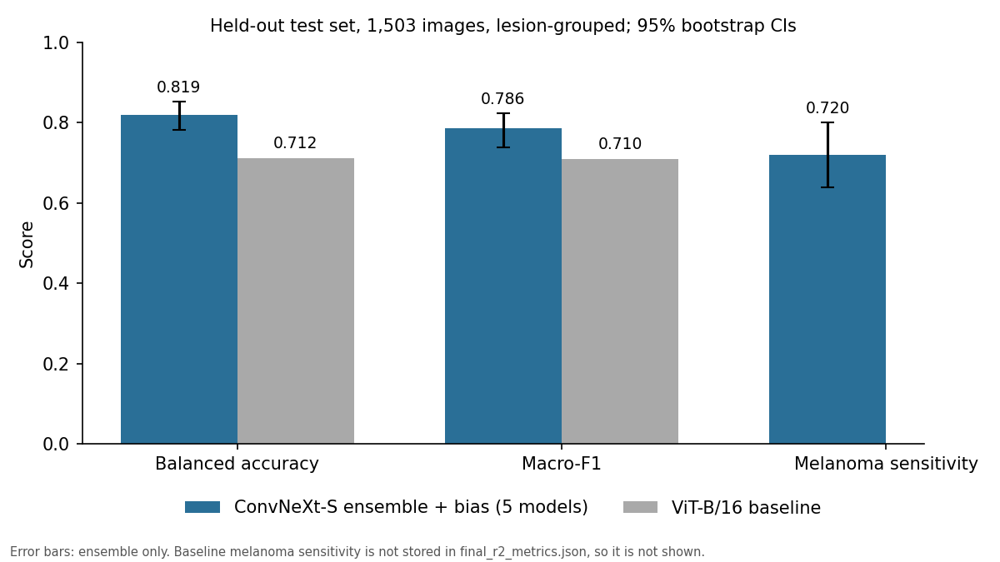
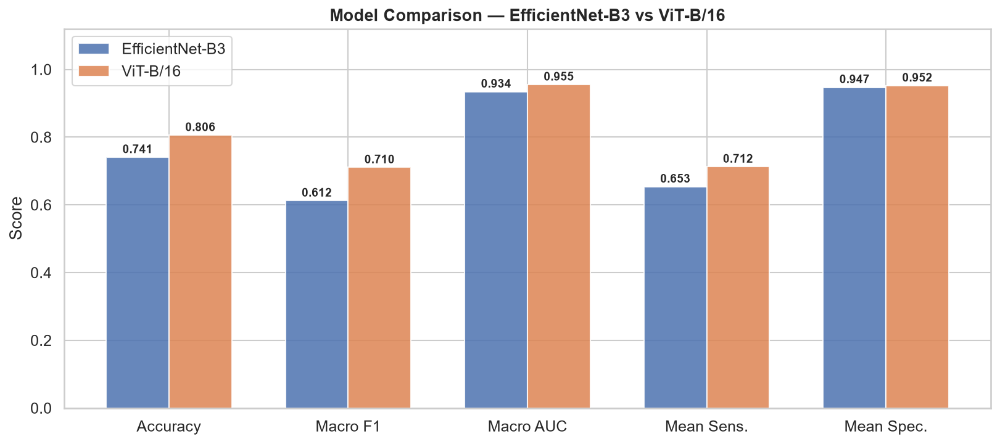
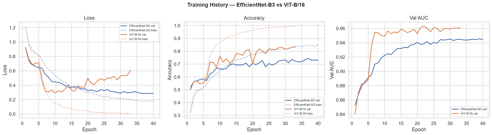
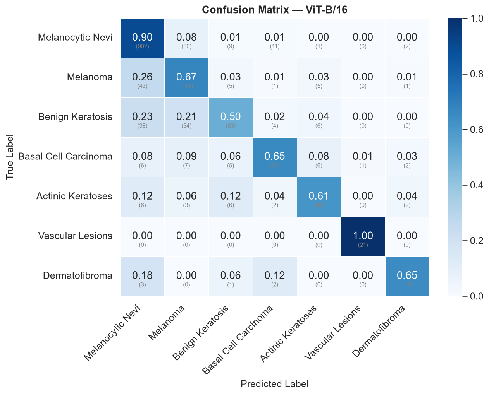
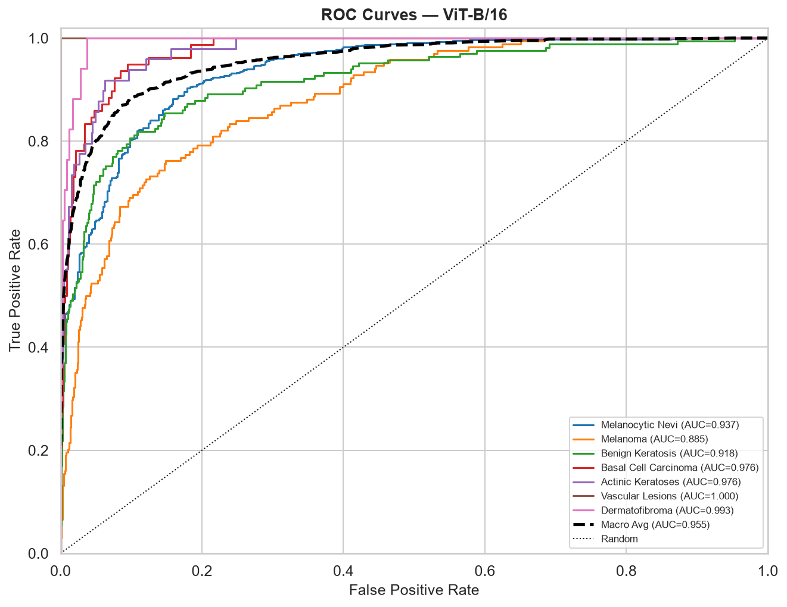

# Skin Lesion Classification (HAM10000)

7-class dermoscopy classifier evaluated on a **lesion-grouped** split (no lesion in both train and test).
Balanced accuracy **0.819** [95% CI 0.783–0.852] for a 5-model ConvNeXt-S ensemble vs **0.712** for a ViT-B/16 baseline, on 1,503 held-out images.
Melanoma sensitivity 0.72: about 1 in 4 is still missed.



*Held-out test set, 1,503 images, lesion-grouped; 95% bootstrap CIs. Built from [`results/final_r2_metrics.json`](results/final_r2_metrics.json) by `scripts/plot_ensemble_vs_baseline.py`.*

> **Research project, not a medical device.** Not clinically validated. See [Limitations](#limitations).

[](https://github.com/Yasir-Alazmi/skin-lesion-classification/actions/workflows/ci.yml)
[](https://python.org)
[](LICENSE)

## Run the API

```bash
pip install -r requirements.txt -r serving/requirements.txt onnx
huggingface-cli download Yasir-Alazmi/skin-lesion-convnext-ensemble --local-dir models/ensemble
python scripts/export_onnx.py --model-dir models/ensemble    # ONNX files must be exported first
MODEL_DIR=models/ensemble uvicorn serving.app:app --port 8080
curl -F file=@data/samples/sample_mel.jpg http://127.0.0.1:8080/predict
```

This serves the **4-member** ensemble with ONNX Runtime (about 3.7 s per image on a laptop CPU, see [ONNX serving](#serving-with-onnx-runtime)). Its test score was not measured; the 0.819 above is the 5-member ensemble. Endpoints: `GET /health`, `GET /info`, `POST /predict`. On Windows PowerShell set the variable with `$env:MODEL_DIR="models/ensemble"` first.

## Results

Held-out test set: 1,503 images (1,118 lesions). 95% bootstrap CIs in brackets (lesion-level resampling, 1,000 resamples, seed 42).

### v2.1: ConvNeXt-S ensemble

Five ConvNeXt-S models (ImageNet-22k pre-training, 384 and 448 px, two seeds, flip test-time augmentation), averaged in log-probability space, with a per-class bias tuned on the validation set. Compared with the v2.0 ViT-B/16 baseline below:

| Model | Accuracy | Macro-F1 | Balanced acc. | Macro-AUC | Melanoma sens. |
|-------|----------|----------|---------------|-----------|----------------|
| **ConvNeXt-S ensemble + bias** | 0.837 [0.815, 0.860] | **0.786** [0.738, 0.824] | **0.819** [0.783, 0.852] | 0.969 | 0.720 [0.640, 0.801] |
| Same ensemble, no bias | 0.850 | 0.780 | 0.770 | 0.971 | 0.649 |
| ViT-B/16 (v2.0 baseline) | 0.806 | 0.710 | 0.712 | 0.955 | 0.673 |

Paired bootstrap difference to the baseline: balanced accuracy +0.063 to +0.153, macro-F1 +0.034 to +0.123 (95% intervals, both exclude 0). Numbers: [`results/final_r2_metrics.json`](results/final_r2_metrics.json). The ensemble's per-image test predictions are not committed; only these aggregate metrics are.

Read these numbers with care:
- **The bias is a trade-off, not free accuracy.** It shifts predictions towards rare classes: balanced accuracy rises from 0.770 to 0.819 while plain accuracy falls from 0.850 to 0.837 (nevus sensitivity 0.88). Its effect was checked by lesion-disjoint cross-fitting inside the validation set (balanced accuracy 0.716 to 0.763 on the held-out half).
- **The test set was looked at twice**: once for the v2.0 baselines and once for this ensemble, whose configuration was fixed beforehand (`scripts/final_eval_r2.py` refuses a second run). Every further change must be judged on validation.
- **The demo runs 4 of the 5 members.** One member (from the first sweep) was not kept as a weights file, so the reported ensemble cannot be re-run exactly; the 4-member ensemble in `models/ensemble/` was not scored on the test set.
- Rare classes are small in the test set (dermatofibroma 17 images, vascular lesions 21), so their per-class numbers are wide.
- **Melanoma is still missed about once in four** (sensitivity 0.72).

### Baselines (v2.0.0)

Evaluated once on the same test set. Full per-class tables: [`results/metrics.md`](results/metrics.md).

| Model | Accuracy | Macro-F1 | Balanced acc. | Macro-AUC |
|-------|----------|----------|---------------|-----------|
| **ViT-B/16** | **0.806** [0.782, 0.830] | **0.710** [0.661, 0.751] | **0.712** [0.663, 0.761] | **0.955** [0.946, 0.964] |
| EfficientNet-B3 | 0.741 [0.715, 0.765] | 0.612 [0.560, 0.655] | 0.653 [0.603, 0.704] | 0.934 [0.921, 0.945] |

ViT-B/16 beats EfficientNet-B3 by 0.098 macro-F1 (95% CI [0.053, 0.151], paired bootstrap).

Melanoma (ViT-B/16): sensitivity **0.673** [0.574, 0.764], specificity 0.907 [0.889, 0.924].




| ViT-B/16 confusion matrix | ViT-B/16 ROC |
|---|---|
|  |  |

EfficientNet-B3 plots and per-class sensitivity/specificity charts are in [`results/`](results/README.md).

### How the ensemble was found

Validation-only results of the two sweeps ([`kaggle/r1`](kaggle/r1/train.py), [`kaggle/r2`](kaggle/r2/train.py), all trained on Kaggle T4 GPUs on the same lesion-grouped split):

| Run | Val. accuracy | Val. macro-F1 | Val. AUC |
|---|---|---|---|
| ViT-B/16 224 (v2.0 pipeline) | 0.812 | 0.684 | 0.955 |
| ViT-B/16 384 | 0.818 | 0.709 | 0.953 |
| EfficientNet-B3 384 | 0.717 | 0.653 | 0.944 |
| ConvNeXt-S 384 (R1) | 0.854 | 0.743 | 0.971 |
| ConvNeXt-S 384, seed 42 / 7 (R2, +TTA) | 0.847 / 0.832 | 0.761 / 0.723 | 0.973 / 0.972 |
| ConvNeXt-S 448, seed 42 / 7 (R2, +TTA) | 0.853 / 0.857 | 0.783 / 0.740 | 0.975 / 0.971 |

- **Higher resolution and a ConvNeXt backbone helped** more than anything else.
- **Metadata (age, sex, lesion site) did not help**: macro-F1 fell from 0.709 to 0.700 (ViT) and from 0.743 to 0.717 (ConvNeXt) when added.
- **Seed noise is large**: the same configuration varied by up to 0.06 in validation balanced accuracy and 0.2 in melanoma sensitivity, so single-run rankings are unreliable; ensembling and bias tuning were judged on lesion-resampled validation data.
- Not tried: external datasets (ISIC 2019 contains HAM10000 images and would need careful de-duplication).

## Evaluation methodology

- **Lesion-grouped split.** HAM10000 has several photos of many lesions. Splitting by image leaks near-duplicates between train and test and inflates scores. Here all images of a `lesion_id` go to one split: 70/15/15 over 7,470 lesions (`StratifiedGroupKFold`, seed 42), 7,009 / 1,503 / 1,503 images. The assignment is committed in [`results/splits.csv`](results/splits.csv).
- **Model selection on validation only.** The best epoch is chosen by validation macro-F1 (ViT-B/16: epoch 26, early stop at 33).
- **Test-set use.** v2.0: used once, after selection, for the two baselines (`results/*_test_predictions.csv`). v2.1: used once more for the fixed ensemble (see above). Nothing was selected or tuned on it.
- **Confidence intervals.** `scripts/report.py` recomputes every number from those CSVs and resamples at the lesion level, so repeated images of a lesion do not shrink the intervals.
- **Earlier numbers retracted.** Earlier versions of this repo reported 94.2% accuracy. Those figures came from a notebook that was not reproducible; they were replaced by the results above in v2.0.0.

## Limitations

- **Single dataset.** HAM10000 only (one source population, dermoscopy). No external validation; performance on other devices, skin types or clinics is unknown.
- **Class imbalance.** 67% of images are nevi. Rare classes have few test lesions (vascular 21, dermatofibroma 17 images), so their estimates are wide.
- **Melanoma sensitivity is 72%** for the v2.1 ensemble (ViT-B/16: 67%, EfficientNet-B3: 53%): roughly one melanoma in four is still missed.
- **Not clinically validated.** No prospective study, no clinician comparison, no calibration analysis. Do not use it for diagnosis or triage.

## Demo

`app.py` is a Gradio app that runs the 4-model ConvNeXt-S ensemble in `models/ensemble/` (hair removal, 384/448 px resize, ImageNet normalisation, flip TTA, class bias; same preprocessing as training) and shows the top-3 class probabilities, with example images from `data/samples/`. On a CPU one image takes roughly 10 seconds (measured at 1.8 s per member at 384 px). The ensemble weights (about 190 MB each) are not stored in git; `models/ensemble/ensemble_config.json` describes them. The v2.0 single-model path remains available via `python demo.py --weights ... `.

```bash
pip install -r requirements.txt
python app.py                                  # http://127.0.0.1:7860
python demo.py --image data/samples/sample_mel.jpg   # command-line version
```

Ensemble weights: `ENSEMBLE_DIR` if set, otherwise `models/ensemble/`, otherwise downloaded from the Hugging Face model repo [`Yasir-Alazmi/skin-lesion-convnext-ensemble`](https://huggingface.co/Yasir-Alazmi/skin-lesion-convnext-ensemble) (`ENSEMBLE_REPO` overrides). That repo holds the **4-member** version; the reported 0.819 is the 5-member ensemble. The v2.0 ViT-B/16 weights are not published; `demo.py --weights` takes a local checkpoint. Checkpoints are not stored in git.

### Hugging Face Space

Not deployed. To deploy one, create a Gradio Space with its own README front-matter (`sdk: gradio`, `app_file: app.py`) and push `app.py`, `src/`, `data/samples/` and `requirements.txt`; the app downloads the ensemble weights from the model repo above on first start.

## Serving with ONNX Runtime

`scripts/export_onnx.py` exports the four ensemble members to ONNX (opset 17). The `serving/` package runs them with ONNX Runtime behind a FastAPI app, and it does not need PyTorch:

```bash
python scripts/export_onnx.py --model-dir models/ensemble   # writes models/ensemble/*.onnx and results/onnx_export.json
MODEL_DIR=models/ensemble uvicorn serving.app:app --port 8080
curl -F file=@data/samples/sample_mel.jpg http://127.0.0.1:8080/predict
```

The endpoints are `GET /health`, `GET /info` and `POST /predict`. The ONNX ensemble applies the same preprocessing, flip TTA and bias rule as the PyTorch code.

From [`results/onnx_export.json`](results/onnx_export.json), measured on 2026-11-25 on a laptop CPU:

| Check | Result |
|---|---|
| Parity with PyTorch on the 9 files then in `data/samples` (7 unique images; 2 files were byte-identical duplicates, since removed) | max absolute probability difference 1.2e-06; top-1 agreement 9/9 |
| CPU latency per image (4 members x 4 flip views, including hair removal) | ONNX Runtime median 3.68 s; PyTorch median 4.15 s |

Parity was checked on the demo images only, not on the test set, which is not re-used. The served model is the 4-member ensemble. Its own test score was never measured, because the reported 0.819 belongs to the 5-member ensemble (see [Limitations](#limitations)). `tests/test_serving.py` checks the preprocessing, the TTA views, the combination rule and the API against the PyTorch code, using small stand-in models.

## Reproduce

```bash
git clone https://github.com/Yasir-Alazmi/skin-lesion-classification.git
cd skin-lesion-classification
python -m venv .venv && .venv\Scripts\activate      # Linux/macOS: source .venv/bin/activate
pip install -r requirements.txt

# 1. Download HAM10000 (Harvard Dataverse, DOI 10.7910/DVN/DBW86T) into <DataRoot>/raw/:
#    HAM10000_metadata.csv, HAM10000_images_part_1/, HAM10000_images_part_2/

# 2. Train both models on the committed split (Windows PowerShell), then evaluate each
#    best-validation checkpoint once on the test set
powershell -ExecutionPolicy Bypass -File scripts\train_all.ps1 -DataRoot D:\skin-lesion-data
powershell -File scripts\train_status.ps1           # progress

# 3. Copy <DataRoot>\runs\<model>\test_predictions.csv to results/{vit,efficientnet}_test_predictions.csv
#    and history.json to results/history_{vit_b16,efficientnet_b3}.json, then:
python scripts/report.py                            # writes results/metrics.{json,md} and figures
pytest tests/ -v
```

Training uses focal loss (gamma 2), AdamW (lr 1e-4), a frozen backbone for the first 5 epochs, ReduceLROnPlateau, a weighted sampler and early stopping on validation macro-F1. Seed 42 everywhere (`src/config.py`).

## Project structure

```
app.py, demo.py        Gradio demo and CLI (real model inference)
src/                   config, split, dataset, preprocess, models, loss, train, evaluate, visualize, inference, ensemble
serving/               ONNX Runtime + FastAPI server (GET /health, /info, POST /predict)
scripts/               train_all.ps1, train_status.ps1, report.py, export_weights.py, final_eval_r2.py,
                       export_onnx.py, plot_ensemble_vs_baseline.py
kaggle/                r1, r2: Kaggle training scripts for the ConvNeXt sweeps (2 x T4)
models/ensemble/       ensemble_config.json (tracked); member weights (.pt, ignored)
results/               splits.csv, test predictions, metrics.{json,md}, figures
tests/                 CPU-only tests (no dataset or checkpoint needed)
data/samples/          example images for the demo
```

## Data and citation

HAM10000: Tschandl, Rosendahl & Kittler (2018), *Scientific Data* 5, 180161, [doi:10.1038/sdata.2018.161](https://doi.org/10.1038/sdata.2018.161) (CC BY-NC 4.0). Hair removal: Black-Hat morphology + TELEA inpainting (Telea, 2004). Loss: Lin et al., Focal Loss (ICCV 2017).

See [CHANGELOG.md](CHANGELOG.md) and [CONTRIBUTING.md](CONTRIBUTING.md). License: MIT.
